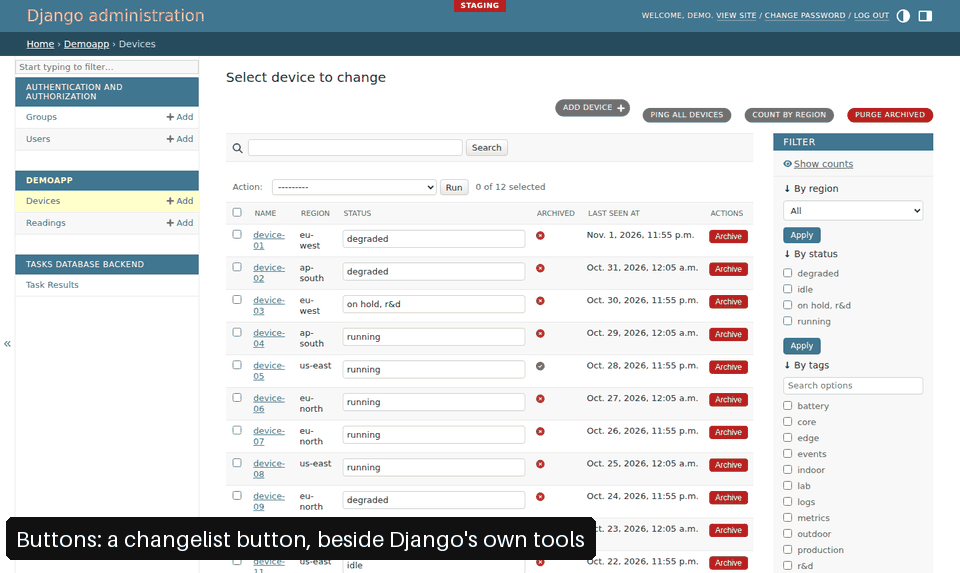

# django-extensions-admin

Small, opt-in utilities for the Django admin you already have: buttons, a JSON editor, list filters,
a management-command runner, branding, an environment indicator and a real Django shell in a side
panel. Each feature is its own small distribution, and none of them does anything until you adopt it.
It adds no theme, no base class you must inherit everywhere and no frontend build step.

<picture>
  <source media="(prefers-color-scheme: dark)" srcset="https://github.com/dmmeteo/django-extensions-admin/raw/main/docs/media/features-dark.gif">
  
</picture>

Recorded from real journeys on the demo project's generated data, in the stock admin's light and
dark themes.

> **Release status.** Version 0.1.0 is prepared but **not yet published on PyPI**. Until the first
> upload succeeds, install it from the repository as shown below.

> **Independent project.** Inspired by the spirit of `django-extensions`, but not official, not
> affiliated with it, and it does not depend on it.

## Features

| Feature | Extra | What you get |
| --- | --- | --- |
| [Buttons](https://github.com/dmmeteo/django-extensions-admin/blob/main/docs/buttons.md) | `buttons` | Changelist, change-form and row buttons. Each one is a CSRF-protected POST with a server-side permission check. |
| [JSON widget](https://github.com/dmmeteo/django-extensions-admin/blob/main/docs/json-widget.md) | `jsonwidget` | An indented, highlighted, validating editor for `JSONField`. Formatting changes whitespace only. |
| [List filters](https://github.com/dmmeteo/django-extensions-admin/blob/main/docs/filters.md) | `filters` | Date, date-time and numeric range filters, and single or multiple choice filters with search. |
| [Management commands](https://github.com/dmmeteo/django-extensions-admin/blob/main/docs/commands.md) | `commands` | An allow-list of management commands, run by a Django Tasks worker. The user who launched a run sees its output. |
| [Branding](https://github.com/dmmeteo/django-extensions-admin/blob/main/docs/branding.md) | `branding` | A logo and brand colours on the stock admin. |
| [Environment indicator](https://github.com/dmmeteo/django-extensions-admin/blob/main/docs/environment.md) | `environment` | A coloured line and a badge naming the environment on every admin page. |
| [REPL](https://github.com/dmmeteo/django-extensions-admin/blob/main/docs/repl.md) in the [tools panel](https://github.com/dmmeteo/django-extensions-admin/blob/main/docs/panel.md) | `repl` | A Django shell for superusers in a resizable side panel. Its process survives navigation and reload. Off until you enable it. |

The core depends on Django alone, and the REPL adds Channels. `[all]` selects every feature.

## Quickstart

You need Python 3.12 or newer and Django 5.2 or 6.0. The packages are not yet published on PyPI, so
build the wheels from a checkout and let pip find them in `dist/`:

```bash
git clone https://github.com/dmmeteo/django-extensions-admin
cd django-extensions-admin
python3 -m venv .venv && . .venv/bin/activate
pip install build
for project in . packages/*; do python -m build --wheel --outdir dist "$project"; done
pip install "Django>=5.2,<7" "channels>=4.1"     # third-party dependencies, from PyPI
pip install --no-index --find-links dist "django-extensions-admin[buttons,repl]"
```

`--no-index` keeps pip from looking the unpublished names up on PyPI. Then adopt each feature as its
page shows, starting with `"django_extensions_admin"` in `INSTALLED_APPS` before
`django.contrib.admin`. The gate runs these commands after the clone, as
[Development](https://github.com/dmmeteo/django-extensions-admin/blob/main/docs/development.md) describes.

## Documentation

- [Installation](https://github.com/dmmeteo/django-extensions-admin/blob/main/docs/installation.md): extras, `INSTALLED_APPS`, adding and removing features.
- [Security](https://github.com/dmmeteo/django-extensions-admin/blob/main/docs/security.md): what each feature enforces on the server.
- [Compatibility](https://github.com/dmmeteo/django-extensions-admin/blob/main/docs/compatibility.md): the tested Python, Django, backend and browser versions.
- [Development](https://github.com/dmmeteo/django-extensions-admin/blob/main/docs/development.md): the demo, the verification gate and CI.
- [Releasing](https://github.com/dmmeteo/django-extensions-admin/blob/main/RELEASING.md),
  [philosophy](https://github.com/dmmeteo/django-extensions-admin/blob/main/PHILOSOPHY.md),
  [roadmap](https://github.com/dmmeteo/django-extensions-admin/blob/main/ROADMAP.md) and
  [architecture](https://github.com/dmmeteo/django-extensions-admin/blob/main/ARCHITECTURE.md).

## License

MIT, see [LICENSE](https://github.com/dmmeteo/django-extensions-admin/blob/main/LICENSE).
