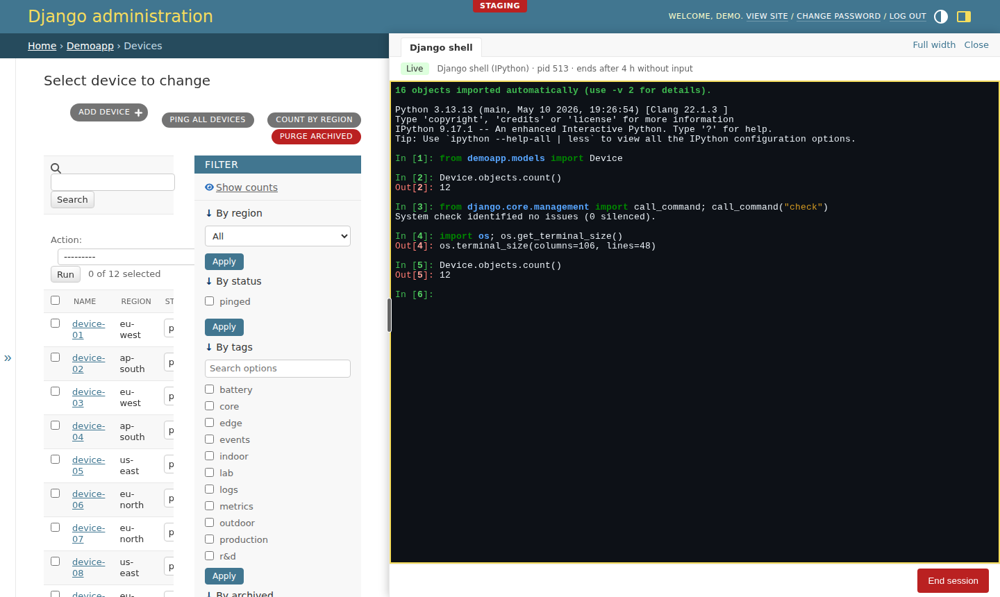

# REPL

A real Django shell for superusers, in the admin's shared [tools panel](panel.md). It replaces
opening an SSH session to run `manage.py shell`. [Ghostty Web](https://github.com/coder/ghostty-web)
(Ghostty's terminal emulator compiled to WebAssembly, vendored unmodified, MIT) renders a
`django-admin shell` process that runs in a pseudo-terminal on the server. The process belongs to
the server, not the page: navigating or reloading reattaches to the same interpreter with its
variables intact.

<picture>
  <source media="(prefers-color-scheme: dark)" srcset="media/panel-repl-dark.png">
  
</picture>

**This is arbitrary code execution with your web server's privileges.** It is off until you turn it
on, and then only for active staff superusers. Read [Security](#security) first.

## Install and enable

```bash
pip install "django-extensions-admin[repl]"     # brings the panel and Channels; not on PyPI yet, see installation.md
pip install ipython                              # optional: the IPython interface
```

Installing changes nothing. The REPL works only after all of these:

```python
# settings.py
INSTALLED_APPS = [
    "daphne",                              # or another ASGI server; see Limitations
    "django_extensions_admin.panel",       # before django.contrib.admin
    "django_extensions_admin.repl",
    "django.contrib.admin",
    ...
]
ASGI_APPLICATION = "mysite.asgi.application"
ADMIN_EXTENSIONS = {"REPL_ENABLED": os.environ.get("ADMIN_REPL") == "1"}
```

```python
# urls.py, before admin.site.urls
path("admin/repl/", include("django_extensions_admin.repl.urls")),
```

```python
# asgi.py
from channels.auth import AuthMiddlewareStack
from channels.routing import ProtocolTypeRouter, URLRouter
from channels.security.websocket import AllowedHostsOriginValidator
from django.core.asgi import get_asgi_application

django_asgi_app = get_asgi_application()

from django_extensions_admin.repl.routing import websocket_urlpatterns  # noqa: E402

application = ProtocolTypeRouter({
    "http": django_asgi_app,
    "websocket": AllowedHostsOriginValidator(AuthMiddlewareStack(URLRouter(websocket_urlpatterns))),
})
```

Then the panel button appears beside the theme toggle for active staff superusers. Inside, **Start
session** launches an interpreter from a server-side list. Rendering a page never starts a process.

## Settings

All in `ADMIN_EXTENSIONS`:

| Key | Default | Meaning |
| --- | --- | --- |
| `REPL_ENABLED` | `False` | Nothing is served until this is `True`: the URLs answer 404 and the WebSocket closes with 4404. |
| `REPL_BACKEND` | `"auto"` | Default interpreter: `"auto"`, `"python"`, `"ipython"` or `"shell_plus"`. |
| `REPL_ALLOWED_BACKENDS` | `None` | `None` offers every available backend, or a list of names. |
| `REPL_IDLE_TIMEOUT` | `14400` | Seconds without the owner's input before the process is ended. |
| `REPL_REPLAY_BYTES` | `524288` | Output kept per session for reload and reconnect. |
| `REPL_STREAM_PATH` | `"/admin/repl/stream/"` | Must match the WebSocket route. |
| `REPL_LOCK_PATH` | `None` | The single-process lock file; defaults to `<tempdir>/django-extensions-admin-repl-<uid>-<settings module>.lock`. It is opened without following symlinks; a lock that cannot be opened answers 503. |

| Backend | Runs | Offered when |
| --- | --- | --- |
| `python` | `django-admin shell --interface python` | always |
| `ipython` | `django-admin shell --interface ipython` | IPython is installed |
| `shell_plus` | `django-admin shell_plus` | `django_extensions` is in `INSTALLED_APPS` |

`auto` prefers IPython, then plain Python. With the REPL enabled, an invalid setting is system check
`django_extensions_admin.E501` and an unavailable configured backend is `E502`; neither is silently
replaced.

## Using it

- Typing, paste, <kbd>Ctrl</kbd>+<kbd>C</kbd>, colours and completion behave like a local terminal.
- The terminal and the server's pseudo-terminal follow every panel width. The server confirms each
  new size before later input, so `os.get_terminal_size()` always matches what you see.
- **Close** (or <kbd>Ctrl</kbd>+<kbd>`</kbd>) hides the panel and keeps the process. **End session**
  signals the process group and every process carrying the session's environment marker; a child
  that starts its own session and clears its environment can escape it.
- After navigation, reload or a dropped connection, recent output is replayed exactly once. Older
  output beyond `REPL_REPLAY_BYTES` is reported as not retained.
- There is no operating-system shell, SQL console or AI assistant. To run a management command, call it:
  `from django.core.management import call_command; call_command("check")`.

## Security

- Enable it only where every active staff superuser may run any code as the server user, read its
  environment and settings (including `SECRET_KEY` and database credentials) and reach whatever the
  server can reach. Python offers no sandbox here: contain the process with a dedicated OS user, a
  container or VM, and network egress limits.
- Serve the admin over HTTPS and keep `ALLOWED_HOSTS` explicit: the WebSocket's origin check is only as
  strict as that list. The REPL's route carries its own `AllowedHostsOriginValidator`, so the check
  holds even if `asgi.py` leaves it out, and `"*"` in `ALLOWED_HOSTS` with the REPL enabled is
  system check error `django_extensions_admin.E503`.
- Every HTTP request and every WebSocket connection checks: REPL enabled, authenticated, active, staff,
  superuser. Each user reaches only their own session; another superuser sees nothing and cannot type
  into, resize or end it. A live stream re-reads the Django session every 10 seconds and closes after
  logout, deactivation or a password change, so a revoked browser keeps its stream for up to 10
  seconds. Closing the stream does not end the user's shell: its process runs on until End session,
  the idle limit or a server restart.
- Starting and ending are CSRF-protected POSTs. The browser sends only a backend name from the server's
  list; no command line, path or shell string from a request is executed.
- Idle expiry counts only the owner's input, so an open tab does not keep a process alive. Input is
  bounded per frame and per session, and retained output is bounded by `REPL_REPLAY_BYTES`.

## Limitations

- Sessions live in memory in **one** ASGI server process. A second process that tries to host sessions
  is refused through the lock file, so run a single worker. A restart ends every session (the server
  ends their process trees on exit), and the panel says the old session is gone.
- Linux only: sessions need pseudo-terminals and `/proc`. Enabled elsewhere, it is system check error
  `django_extensions_admin.E504`.
- A server that is killed outright (SIGKILL, OOM) cannot end its sessions' processes; a normal stop
  does.
- The terminal compiles WebAssembly: a Content-Security-Policy on admin pages needs
  `'wasm-unsafe-eval'` in `script-src` for the REPL. The panel and the other features need nothing
  extra.
- With signed-cookie sessions, the 10-second recheck cannot see a logout (the cookie still decodes);
  deactivation and a password change are still seen.
- Output is pushed as fast as the shell writes it; a client on a very slow connection buffers in the
  server process.
- Each time the terminal's size changes, the panel replays the retained output at the new size a
  quarter of a second after the last change, on a new terminal. This works around two defects in the
  vendored ghostty-web 0.4.0: it can leave stale cells when it reflows rows, and resetting or
  clearing a terminal that was resized corrupts its WebAssembly memory, so that later output traps
  out of bounds and stops appearing. The panel therefore never resets a terminal: it builds a new one
  on a new WebAssembly instance. Full-screen IPython redraws can still show leftover fragments above
  the prompt after several resizes; plain Python output replays intact.
- Sessions are bound to the user's primary key. Deleting a superuser closes their live stream, but
  their process keeps running until End session, its idle limit or a restart; a new account that
  reused the same primary key before then would reach it.
- Tested with daphne 4.2.3 and channels 4.3.2 only, in Chromium only.

## Removing it

Remove the `REPL_*` settings, the URL include, the WebSocket route and `django_extensions_admin.repl`
from `INSTALLED_APPS`, then `pip uninstall django-extensions-admin-repl`. It has no models or migrations;
a server restart ends any session. The panel goes with it once no tool uses it
(`pip uninstall django-extensions-admin-panel channels`).
